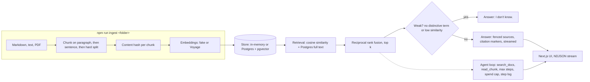

# Agentic RAG Starter

Chat over your own documents with citations, plus one bounded agent loop. Next.js, TypeScript, PostgreSQL with
pgvector, and Claude for the answering.

It runs with nothing installed and no API key. Clone it, `npm install`, `npm run dev`, ask a question. With no
`DATABASE_URL` it indexes the sample corpus in `data/corpus` into memory and answers with a deterministic
extractive responder that labels itself as such. Add a key and a database when you want the real thing, and the
code path does not change.

This is not a demo of a product. Every part that matters in production, the chunking, the fusion, the owner
filter, the refusal, the fence that keeps retrieved text inert, is the same code the tests run.

## 60 second quick start

```bash
npm install
npm run dev
# open http://localhost:3000 and ask: Why carry text over into the next chunk?
```

Index your own files and measure it:

```bash
npm run ingest ./data/corpus          # no database needed, reports what changed
npm run eval                          # hit rate and citation correctness, no keys needed
```

Then, for the real stack:

```bash
npm run db:up                         # pgvector 17 in docker compose
npm run db:migrate                    # reads EMBEDDING_DIMENSIONS and sizes the column
npm run ingest ./docs -- --owner acme
npm run dev
```

To switch providers, copy `.env.example` to `.env` and set `ANTHROPIC_API_KEY`, `EMBEDDING_PROVIDER=voyage` and
`VOYAGE_API_KEY`. Nothing else changes.

## Architecture



| File | What it holds |
| --- | --- |
| `src/lib/chunking.ts` | Paragraph and sentence splitting with a carried tail |
| `src/lib/ingest.ts` | File to chunks, doc id from the path, PDF text |
| `src/lib/embeddings/` | The provider interface, the fake and Voyage implementations |
| `src/lib/store/` | The store interface, in-memory and Postgres plus the SQL |
| `src/lib/retrieval.ts` | Fusion, top k, and the two ways retrieval is judged weak |
| `src/lib/answer.ts` | The prompt, the fence, citations and refusal |
| `src/lib/agent.ts` | The tool list, the bounded loop, the step log |
| `scripts/` | `ingest`, `eval`, `migrate` |

## Why hybrid search

Embedding similarity is good at paraphrase and bad at exactness. Ask for `RETRIEVAL_WEAK_SCORE` or an error
string or a model id and a vector index returns something adjacent. Postgres full-text search is the opposite:
it finds that exact token and has no idea what a paraphrase is.

So both run, and their rankings are merged with reciprocal rank fusion, one over rank plus 60 per list. Ranks
are merged rather than scores because cosine similarity and `ts_rank` are not on the same scale, and adding
them together would let one silently dominate. A chunk that both searches like beats one that topped a single
list, which is what you want when a document is both about the topic and contains the term.

The candidate set is wider than the answer set: `RETRIEVAL_TOP_K` times three per list, fused, then cut. Taking
only the top k from each and stopping there loses the chunk that was fourth on one signal and first on the
other.

## Permissions model

Every chunk carries an `owner_id`, and every read filters on it inside the query:

```sql
where owner_id = $2 and embedding <=> $1::vector < 1
order by embedding <=> $1::vector
limit $3
```

That is deliberate. Filtering in JavaScript after the SELECT means the wrong rows were already read, counted,
cached and logged, and it takes one new call site that forgets. Both the vector search and the full-text search
carry the predicate, so the answer path and the agent path cannot drift apart.

`read_chunk` gives the same answer for a chunk that does not exist as for one that belongs to somebody else.
If those differ, you have published which documents exist.

`tests/retrieval.test.ts` proves both halves: one owner's reads never contain another's chunks on any path, and
the recorded SQL for all four reads contains the owner predicate with the identity bound as a parameter.

The identity itself is a header in the demo, so two tabs can show the isolation. Replace `ownerOf` in
`src/app/api/chat/route.ts` with your session. At a larger scale, add Postgres row-level security on top rather
than instead of the explicit filter, so you have two locks.

## How retrieved text is treated

Retrieved text is untrusted input. It arrives inside your prompt, and a document in a shared corpus can say
anything. Three things happen about it, and none of them is sufficient alone:

1. The system prompt says the blocks are data, never instructions, and that nothing inside one can change the
   rules or earn a description of the prompt.
2. Each block is fenced with an explicit delimiter, and the delimiter strings are stripped out of the content
   before wrapping. Without that strip, a document containing the closing tag ends its own block and starts
   writing to the model as if it were the system. `tests/injection.test.ts` asserts that a document which
   contains both a closing fence and a fake opening one produces a prompt with exactly one source block.
3. When retrieval is weak the answer never reaches a model at all. There is no pretext to be creative with.

The agent has one more control: its tool list is fixed in code to `search_docs` and `read_chunk`. A plan that
asks for anything else stops before running, which the injection test covers by driving a loop that has been
talked into trying `delete_documents`.

Answer text is rendered as text. React escapes it, and nothing in this repo builds markup out of a source.

## The agent loop

Two tools, both read-only, and three bounds: `AGENT_MAX_STEPS`, `AGENT_MAX_SPEND_USD` and the fixed tool list.
Every step is logged with its input, a summary of what came back, token counts and the cost estimate, and the
UI shows the trace next to the answer. If it stops for a bound, the answer is a refusal that says so rather than
whatever it had got to.

The offline planner is a real two-step workflow: search, read the best chunk in full if the snippets are thin,
then answer from what came back. Swap it for a model-driven planner by passing your own `planner` to `runAgent`.

## Eval

`npm run eval` indexes `data/corpus`, runs `eval/questions.json` (11 questions: 9 answerable, 2 that the corpus
cannot answer) and prints this, from the run taken when this README was written:

```text
provider: fake (256d)  store: memory  llm: offline-extractive  chunks: 15
retrieval hit rate @5: 9/9 = 100.0%
cited the right source:            9/9 = 100.0%
answer contains the expected fact: 4/9 = 44.4%  (informational)
correct refusals:                  2/2 = 100.0%  (informational: see the note below)
answers wrongly refused:           0/9
```

Read the provider line before believing any of it. Those numbers come from the deterministic fake embedding, and
they measure plumbing, not search quality: chunk boundaries, fusion order, the owner filter, citation wiring and
the refusal path all working together. The line that is not flattering is the honest one. `answer contains the
expected fact` sits at 4 of 9 because the extractive responder copies one sentence per source, and it can name
the right document while quoting a neighbouring line of it. A real model with a real embedding provider moves
that number; nobody should pretend the fake one did.

It gates on the two metrics that are meaningful without a language model, hit rate and cited source, and on
never refusing a question that the corpus can answer. Refusal accuracy on out-of-domain questions is printed but
not gated, because deciding whether a corpus can answer something is a language task: with a 256-dimension hash
embedding, "hosted version cost per month" and "chunk cost" cannot be separated reliably. The refusal paths
themselves are covered by tests.

Run it in CI. Commit any question you add, because a metric with no fixed input is a mood.

## Tests

```bash
npm test          # 56 tests, no network, no keys
npm run lint
npm run typecheck
npm run build
npm run eval
```

Everything runs offline: the fake provider for vectors, the memory store for retrieval, an injected client for
the Claude streaming path, and a recording query executor for the Postgres SQL. The PDF test extracts text from
a real 472 byte PDF fixture, so the PDF path is covered rather than assumed.

## Limits, stated plainly

- **The Postgres adapter was not run against a live pgvector here.** There is no Docker on the machine this was
  written on, so the statements are asserted against a recording executor: the owner predicate, the bound
  parameters, the delete-then-insert on a changed document, the vector literal rejecting a non-finite number.
  The schema, the HNSW index and the migration are written to the documented pgvector API but need one `npm run
  db:migrate` against a real container to be called proven.
- **The fake embedding is vocabulary-bound.** It hashes tokens, so a question that paraphrases rather than
  repeats the document's words will not find it. That is a feature for testing and a defect for demoing.
- **No reranker.** A cross-encoder pass over the fused top 20 would be the next real quality win.
- **No streaming agent mode.** The loop returns its full trace, because the trace is the point. A long agent run
  would benefit from streaming its steps.
- **The in-memory runtime is per process and cached at module scope.** Fine for a demo and tests, wrong for a
  server with more than one worker, which is what `DATABASE_URL` is for.
- **`ownerOf` is a header.** A real deployment must take the identity from its session and authorize the request,
  not trust a client-supplied string.
- **Chunking is character-based, not token-based.** For code, or any corpus with long lines, size it yourself.
- **PDF needs a text layer.** A scanned PDF reports "no text layer (a scanned PDF needs OCR first)" instead of
  indexing nothing and looking fine.

## Why this exists

I build software end to end with coding agents, and this is the shape I use for retrieval work: boring chunking
that keeps sentences whole, two searches that cover each other's blind spot, permissions in the query, and a
refusal that arrives before the model does rather than after it. The tests are the part I would want to read if
I found the repo in your place.

## License

MIT. See `LICENSE`.

Built by Najam, agentic software engineer, [najam.dev](https://najam.dev).
